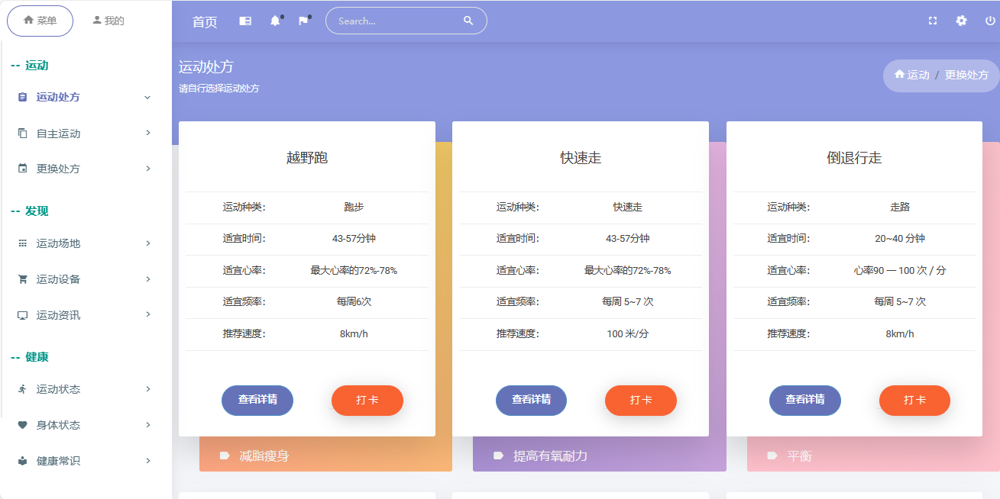
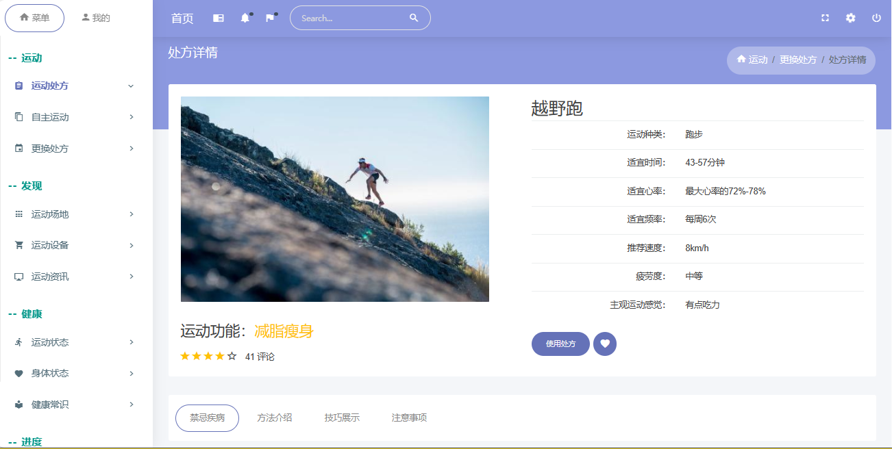
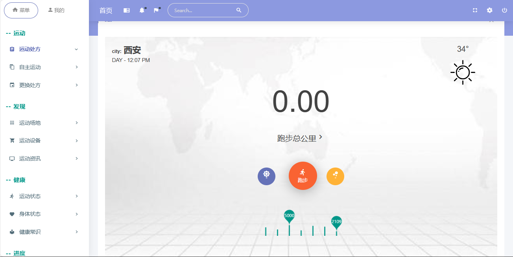
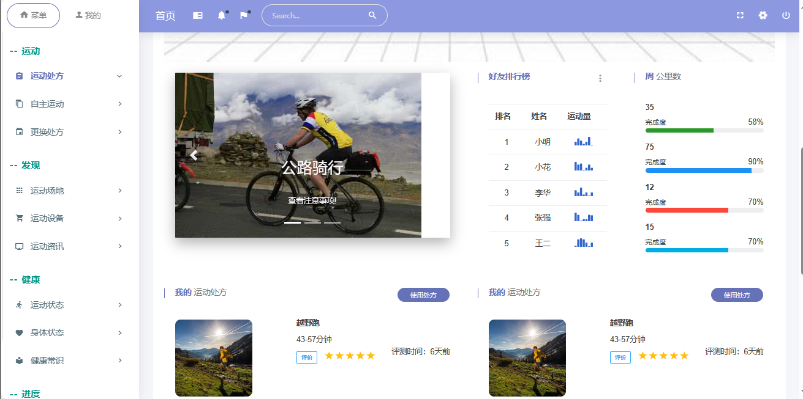
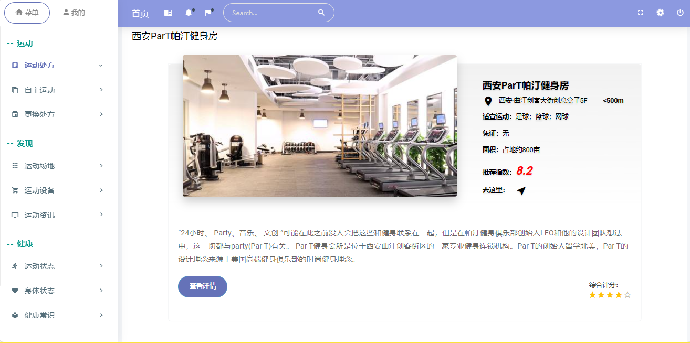
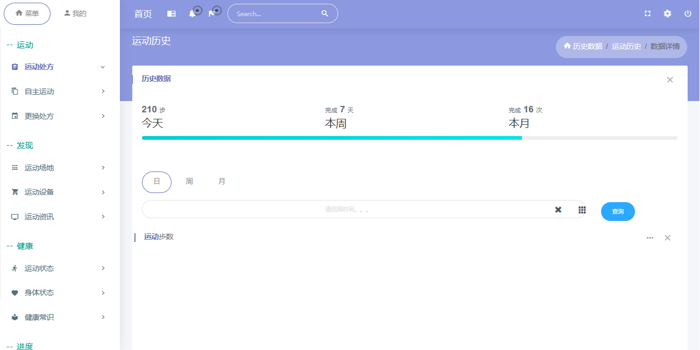
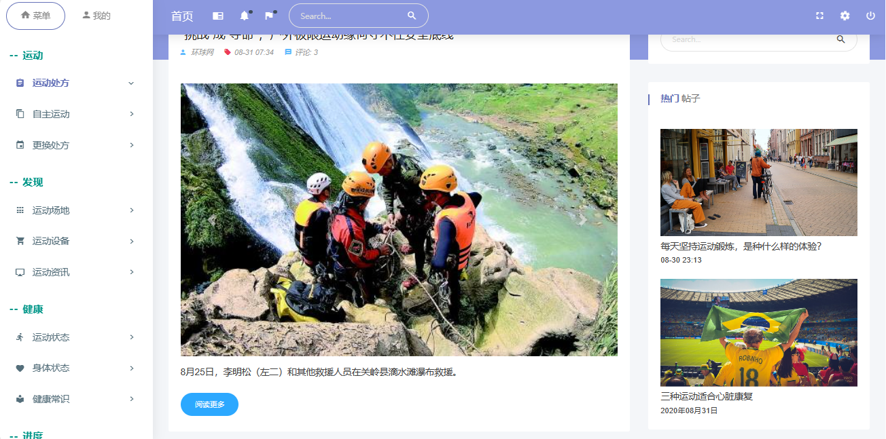
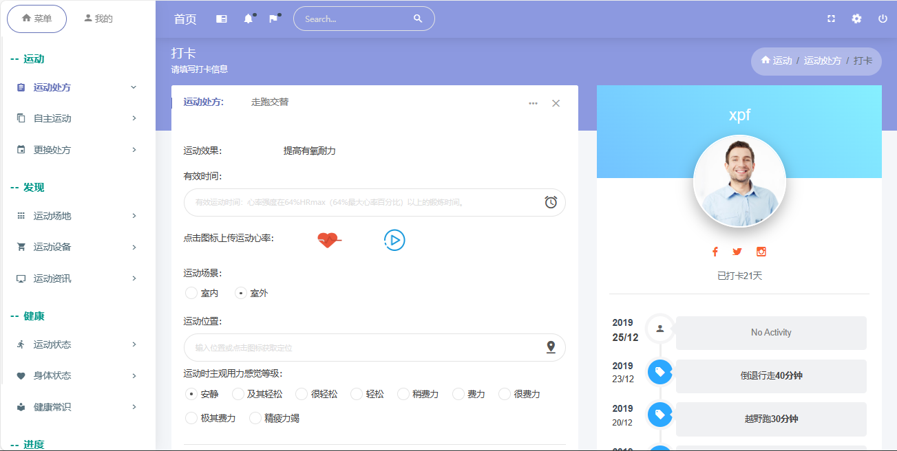
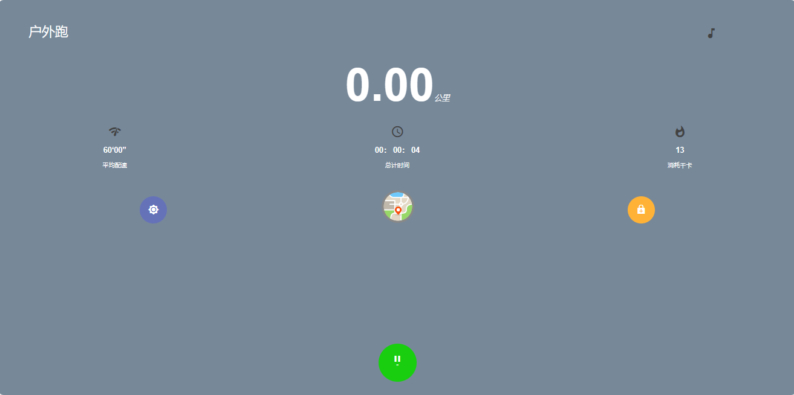

<p><h1 align="center">S002.基于Springboot的个人健康监控管理系统【含报告文档】</h1></p>

###  获取完整源码和sql数据库文件（完全免费）:  微信: littlepinia88 qq：1104515926
###  所有项目以及源代码本人均调试运行无问题 可支持远程安装部署调试、定制修改、代码讲解

## 简介

> 本代码来源于网络,仅供学习参考使用!
>
> 提供1.远程部署/2.修改代码/3.设计文档指导/4.框架代码讲解等服务
>
> http://localhost:8088/index.html
> 

## 项目介绍
本项目是一个基于 Spring Boot 的个人健康监控管理系统，面向个人运动健康自评与处方推荐场景，采用「用户端网页 + 后台管理」一体的服务端渲染结构，打通了用户注册登录、体质测评、个性化运动处方推荐、自主运动打卡与数据统计、健身场地与课程浏览、后台处方与基础数据维护的健康管理闭环。页面由 Thymeleaf 渲染，前端使用 jQuery + Bootstrap，可作为健康管理类课程设计或毕业设计案例。

### 系统角色
- **普通用户**：注册登录后完善个人身体数据（身高、体重、BMI、既往病史等），进行体质测评，获取个性化运动处方，记录跑步、骑行等运动数据并打卡。
- **管理员**：登录后台，维护运动处方、课程、疾病、器材、疲劳度、健身场地等基础数据，并管理注册用户。
- **权限控制**：登录成功后将用户或管理员对象写入 HttpSession（30 分钟过期），未配置统一拦截器，需登录的接口在方法内手动校验 Session 中的登录对象。

### 前台功能
1. **注册登录与个人资料**：账号注册、登录、退出，维护身高、体重、腰围、胸围、臀围、既往病史、运动目标与偏好器材等资料。
2. **体质测评**：填写身体指标后由 `CorporeityAssessment` 工具按规则生成体质与运动能力评估结果。
3. **运动处方推荐**：按年龄、功效、疾病等条件查询标准处方与力量处方，生成个性化处方。
4. **自主运动记录**：记录跑步、骑行等运动，按日、周、月统计运动数据，支持运动打卡。
5. **场地与课程浏览**：按类型浏览健身场地，观看运动教学课程视频。
6. **资讯与数据接入**：浏览健康新闻、话题与赛事信息；心率数据可通过 Jsoup 抓取外部网页接入。

### 管理端功能
1. **管理员登录与用户管理**：管理员登录后台，查看与删除注册用户。
2. **处方管理**：有氧与力量标准处方的新增、编辑、删除与分页查询。
3. **基础数据维护**：运动课程、疾病库、健身器材、疲劳度、健身场地的增删改查。

### 技术栈
- **后端框架**：Spring Boot 2.1.13.RELEASE、Spring MVC、MyBatis（mybatis-spring-boot-starter 1.1.1）
- **数据访问**：MySQL 5.1.46 驱动，库 `s002_sport`；Druid 1.1.19 数据源；MyBatis Generator 1.3.5 生成代码
- **模板与前端**：Thymeleaf 服务端模板，页面使用 jQuery + Bootstrap，后台基于 Bootstrap 管理模板
- **工程能力**：统一 `ServerResponse` 响应模型、Fastjson、阿里云 OSS 图片上传（aliyun-sdk-oss 3.10.2）、Apache Jena 3.8.0（实际仅使用其 atlas.json 工具包）、Jsoup 1.7.3 网页抓取、Lombok

### 核心数据表
- `t_user` 用户表：账号 `userAccount`、密码、身高 `userHeight`、体重 `userWeight`、BMI `userBmi`、病史 `userDisease`、运动目标 `userSportObjective1`
- `t_admin_user` 管理员表：账号、密码
- `t_standard_recipe` 标准运动处方表、`t_individuation_recipe` 个性化处方表、`t_user_recipe` 用户处方表
- `t_run_data` 运动记录表：按用户记录跑步与骑行数据
- `t_fitness_venues` 健身场地表、`t_course` 运动课程表、`t_sport_equipment` 器材表
- `t_disease` 疾病表、`t_disease_recipe` 疾病与处方关联表、`t_fatigue_degree` 疲劳度表、`t_user_tizhi` 体质测评结果表

### 工程结构
```
S002HealthySport
├── src/main
│   ├── java/com/sports
│   │   ├── controller/    用户端与管理端控制器（User/Admin/Healthy/RunData/Recipe 等）
│   │   ├── service/       业务接口与实现
│   │   ├── dao/           MyBatis Mapper 接口
│   │   ├── entity/        实体类
│   │   ├── tools/         体质测评 CorporeityAssessment 等工具
│   │   └── common/        响应模型、OSS 配置、常量
│   └── resources
│       ├── application.yml / application-dev.yml  端口 8088、数据源、OSS 配置
│       ├── mappers/        MyBatis Mapper XML
│       └── templates/      Thymeleaf 页面（用户端 html + manage 后台模板）
└── screenshot/              运行截图
```

### 补充说明
- 端口 8088、库名 `s002_sport` 见 `application-dev.yml`，首次运行需先建库并导入 SQL。
- 图片上传走阿里云 OSS（bucket `sport-image-manage`、endpoint `oss-cn-beijing.aliyuncs.com`），`accessKeyId` / `accessKeySecret` 以明文写在 `application-dev.yml` 中，为原作者账号，二次开发需替换为自己的凭据。
- 密码明文比对、无统一鉴权拦截器，仅适用于教学演示。

## 项目描述
本项目提供一种健康监控管理系统,包括身体指标获取模块和健康报告生成模块,其中,身体指标获取模块,用于获取各项身体指标;健康报告生成模块,用于根据获取的各项身体指标以及用户输入的健康报告指令生成相对应的健康报告.本发明通过身体指标获取模块对用户的身体健康状况进行自检,并获取相应的各项身体指标,同时通过健康报告生成模块为用户生成相应的健康报告,使得用户可以通过健康报告了解自身的健康状况,并根据健康报告调整自身的饮食,运动等,从而对用户健康进行全面管理.
本文基于Springboot+Jean推理机+Jsoup实现的个人健康监控管理系统，健康管理包括：健康体检、健康评估、健康促进和健康服务四大部分。具体来说健康管理就是由健康管理顾问根据个人的性别、年龄、身体状况、居住环境、医疗服务的使用情况以及职业特性等综合因素，制定一些饮食保健以及营养学的建议，实施特定的干预措施和心理暗示，人体的健康状况进行合理的调整与休息，有效地改善亚健康出现的疲劳、头痛、失眠等不适症状。同时，健康管理机构根据个人在疾病的潜在危险因素，从而有效地对潜在的疾病实行预防、治疗及控制。

## 环境

- <b>IntelliJ IDEA 2021.3</b>

- <b>Mysql 5.7.26</b>

- <b>JDK 1.8</b>

## 运行截图
















